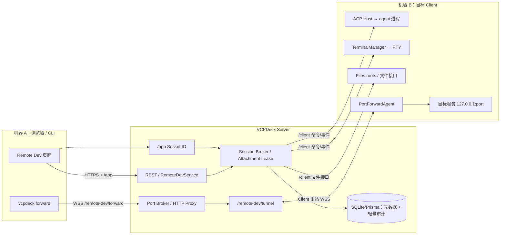
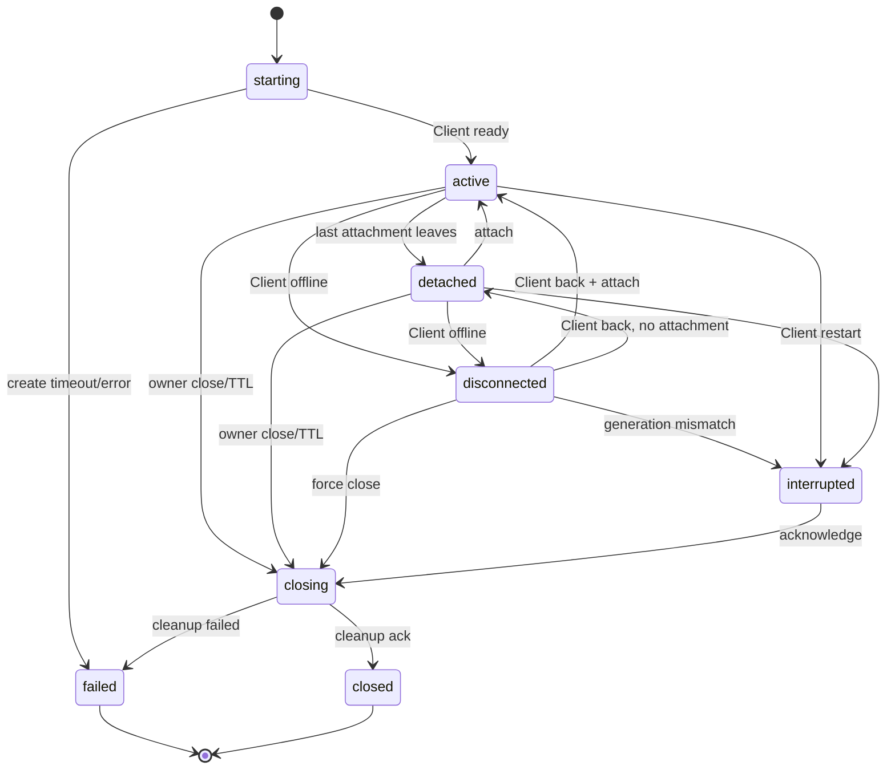

# VCPDeck Remote Dev Session 设计

> 状态：Current（v1 已落地；未完成项见 §18）
> 维护责任：Remote Dev Session 模块负责人
> 最后核验：2026-10-19
> 适用版本：`0.21.0` / 当前 `main`；方向由 [ADR-0058](../adr/0058-remote-dev-session.md)（Accepted）约束
> 事实来源：当前代码、`packages/shared/src/`、Prisma schema 与配置读取逻辑；§18 列出与设计的当前偏移。

## 1. 问题与目标

主人有两台机器、两个 Client，希望从任意一端的浏览器或 agent 进入另一端的开发会话，并且体验接近“坐在目标机前”：

- 和 agent 多轮对话，看到流式输出、工具调用和权限请求；
- 打开目标机终端，运行构建、测试、dev server；
- 浏览和少量修改目标机 workspace 文件；
- 访问目标机上的 dev server、调试端口、数据库等本地服务；
- 刷新页面、换机器、短暂断网后还能接回同一个会话；
- 会话结束或超时后，agent 进程、PTY、端口监听和隧道全部回收。

当前没有这样一个“开发会话”容器。Terminal、Files、Job、FRP 和 A2A Task 各自解决一段问题，但组合起来需要人工在多个页面和命令之间切换，端口还要依赖静态 FRP 暴露。RDS 的目标是把这些能力收敛到一个有明确生命周期、所有权和安全边界的人机会话里。

### 1.1 成功标准

1. 机器 A 的浏览器可以创建机器 B 的 RDS，不需要 B 有入站端口，也不依赖 A 的 Client 在线。
2. agent 对话、权限、取消、终端、文件、端口在同一个页面完成；刷新后能接回。
3. 目标机上的 dev server/调试端口可以通过 `vcpdeck forward` 映射到用户机器 loopback；会话关闭后监听和隧道流不残留。
4. Server 或 Client 重启后，系统如实标记 `interrupted`/`disconnected`，不伪装恢复旧 agent 或旧 PTY；已结束的会话可以从会话历史里被找到，并由操作者**显式续接**（复用原 ACP sessionId，见 §7.2）。
5. 数据库、普通日志和错误中不出现 agent 正文、终端正文、文件内容、token 或完整敏感路径。

## 2. 非目标

- 不把 RDS 做成 A2A Task，不写 `TaskEvent`，不做 `intent/acceptanceCriteria/constraints` 和偏差判定。
- 不做完整 IDE、语言服务器、代码补全、远程桌面或多人协同编辑。
- 不在 v1 做 DAP 代理、端口自动发现、浏览器内调试器。
- 不在 v1 做 DSH 原生 Web UI 的反向代理；这属于独立的通用 Web 代理决策。
- 不做多租户、按身份的资源级 ACL、公网匿名访问或跨 Server 联邦。
- 不集中管理 agent 模型、凭据、订阅、扩展 Bundle 或会话正文。
- 不保证任意 dev server 都能被路径式 HTTP 代理无感兼容；TCP forward 是兼容性主路径。
- 不把 ACP 暴露给浏览器或调用方；浏览器只看到 VCPDeck 标准化事件。

## 3. 概念与数据权威

| 概念 | 含义 | 权威 |
| --- | --- | --- |
| `RemoteDevSession` | 一次跨机人机开发会话，绑定目标 Client、agent placement、workspace | Server 保存元数据；Client 保存运行资源 |
| `target Client` | 实际运行 agent、PTY、文件和端口监听的机器 | Client |
| `agent placement` | 目标机上可启动的 agent 配置/注册项，不是任意命令行 | ADR-0057 的 registry（已落地） |
| `workspace` | 目标机上的一个文件 roots 子目录，经 canonical 校验 | Client 文件系统 |
| `attachment` | 一个浏览器标签页/连接对 RDS 的附着 | Server 内存 lease |
| `operator` | 唯一可发 prompt、输入终端、打开端口、回答权限的附着者 | Server 仲裁 |
| `viewer` | 只读观察者；可看事件/终端输出/文件，不可输入 | Server 仲裁 |
| `port forward` | 会话内显式打开的目标机 loopback 端口映射 | Server 记录；Client 连接目标；CLI 本地监听 |
| `tunnel` | Client 出站到 Server 的认证二进制 WebSocket，承载端口流 | Server + Client |

### 3.1 RDS、Task、Terminal 的区别

| 维度 | A2A Task（ADR-0057） | Remote Dev Session | Terminal Session |
| --- | --- | --- | --- |
| 目的 | 自动化委派一件工作 | 人机共同开发 | 一个 PTY |
| 生命周期 | `submitted → working → … → terminal` | 见 §6 状态机 | `starting → active/detached → closed` |
| 审计 | TaskEvent、验收、偏差 | 轻量生命周期/端口/权限元数据 | TerminalAudit |
| 交互 | A2A Message | ACP 对话 + 终端 + 文件 + 端口 | 终端输入/输出 |
| 产物 | Artifact | 无强制产物；文件/diff 在目标机 | 无 |
| 调用方 | agent | 人（浏览器），后续可 SDK/CLI | 人 |

RDS 可以复用 ADR-0057 的 ACP Host、现有 Terminal/Files；端口隧道是本设计新增，但**不能**把 RDS 的聊天、终端输出或端口事件写进 TaskEvent；如果未来从 Task 打开 RDS，只记录 `remoteDevSessionId` 引用。

## 4. 架构与组件



### 4.1 Server 组件

- `RemoteDevService`：REST 入口、参数校验、分页、权限、创建/关闭编排。
- `RemoteDevSessionBroker`：RDS 状态机、Client 命令、事件归一化、attachment/lease、重连和 GC。
- `RemoteDevPortBroker`：端口记录、token、allowlist、TCP/HTTP 流分配、隧道生命周期。
- `RemoteDevAudit`：轻量审计写入；只写安全元数据。
- `RemoteDevHttpProxy`：路径式 HTTP/WebSocket 预览；可选，Phase 3。
- `RemoteDevTunnel`：Client 出站隧道和 CLI 转发的二进制多路复用端点。

### 4.2 Client 组件

- `RemoteDevAgentHost`：启动 ACP agent，维护一个 ACP 会话；把 ACP 事件归一化为 VCPDeck 事件；处理 prompt/cancel/permission/config。复用 ADR-0057 已落地的 ACP Host 与 AgentPlacement；RDS 仍需自己的会话生命周期、附着与端口数据面。
- `TerminalManager`：复用现有 PTY、snapshot、operator/viewer 和进程树清理；RDS 只增加父会话关联。
- `Files`：复用现有 roots、读/写/列目录/导入导出；RDS 只传 workspace 和会话上下文。
- `RemoteDevPortForwardAgent`：按命令连接 `127.0.0.1:port`，把字节流交给隧道；不监听公网。
- `RemoteDevRuntimeRegistry`：按 `sessionId` 跟踪 agent、PTY、端口流和清理状态，供状态报告和孤儿回收。

### 4.3 Frontend

一个 `RemoteDevSessionPage`，包含：

- 顶部：目标 Client、agent placement、workspace、状态、operator、关闭/接管；
- `Agent` 面板：消息流、工具卡片、权限对话框、取消、模型/配置选项、agent 重启；
- `Terminal` 面板：xterm，多标签（v1 一个，后续多个）；
- `Files` 面板：workspace 树、文本查看/小改、下载/上传；不做完整编辑器；
- `Ports` 面板：打开端口、复制预览 URL/forward 命令、查看状态、关闭；
- `Logs` 面板：只显示生命周期和安全错误，不显示正文。

### 4.4 控制面与数据面

- 控制面：浏览器 ↔ Server 用 REST + `/app`；Server ↔ Client 复用 `/client` Socket.IO 和 Shared 事件。
- 数据面：端口流走独立 `/remote-dev/tunnel`（Client 出站）与 `/remote-dev/forward`（CLI 入站）；HTTP 预览由 Server 代理到隧道。
- 不把大块二进制/HTTP body 塞进 `/client` 业务事件；Socket.IO 只传命令、状态和归一化 agent 事件。

## 5. 数据模型与持久化

### 5.1 拟议表

`RemoteDevSession`：

| 字段 | 说明 |
| --- | --- |
| `id` | RDS id |
| `ownerIdentityId` | 创建者；当前单信任域下的业务身份 |
| `clientId` | 目标 Client |
| `agentPlacementId` | 受控 agent placement；不存任意命令行 |
| `workspaceRoot` | 目标机 canonical 路径；访问受控，日志脱敏 |
| `status` | 见状态机 |
| `agentStatus` | agent 子资源最近已知状态：`starting/ready/busy/idle/exited/failed`；断线后可能过期，以 Client 状态报告为准 |
| `generationId` | Client 运行时代次，用于对账 |
| `lastSeq` | 最近一次已转发事件序号（可空） |
| `createdAt/updatedAt/lastAttachedAt/expiresAt/closedAt` | 生命周期 |
| `closeReason` | `owner/ttl/max_lifetime/client_restart/error` |
| `cleanupStatus` | `complete/partial/unknown` |

`RemoteDevPort`：

| 字段 | 说明 |
| --- | --- |
| `id` | 端口记录 id |
| `sessionId` | 所属 RDS |
| `remotePort` | 目标机 loopback 端口 |
| `protocol` | `tcp`/`http` |
| `label` | 用户可读标签 |
| `status` | `opening/open/failed/closing/closed` |
| `createdAt/expiresAt/closedAt` | 生命周期 |
| `lastErrorCode` | 稳定错误码，不含敏感信息 |

`RemoteDevAuditEvent`：`id/sessionId/eventType/actorIdentityId/metadataJson/createdAt`。事件类型至少包括 `created/attached/detached/takeover/agent_started/agent_exited/permission_resolved/port_opened/port_closed/closed/interrupted`。`metadataJson` 只允许端口号、协议、agent placement id、错误码、attachment 模式等安全字段。

### 5.2 不持久化

- agent 对话、thought、工具输入/输出、权限原始 payload；
- 终端输入/输出/snapshot；
- 文件正文、文件列表、完整路径（审计只存必要路径或哈希，默认不存）；
- 端口 token、Cookie、Authorization、环境变量；
- 隧道原始字节。

### 5.3 事件缓存

为了刷新/短暂断网后仍能看到最近上下文，Client 与 Server 各保留一个有界内存 ring：

- 每 session 最近 `500` 条归一化 agent 事件，或 `1 MiB`，先到先限；
- ring 不落库；Server 重启、Client 重启后丢失；
- 重新 attach 时先发 `rds:state`，再发 ring 中未确认的事件，最后接实时流；
- 浏览器按 `seq` 去重/补洞；无法补洞时显示“上下文可能不完整”，不伪造历史。

## 6. 生命周期与状态机



### 6.1 创建

1. 浏览器 `POST /remote-dev/sessions`，提交 `clientId`、`agentPlacementId`、`workspace` 别名/相对路径、可选标签。
2. Server 校验身份、Client 在线、capability、placement 归属、workspace 是否在 roots、并发/端口限制、幂等键。
3. Server 先写 `starting` 记录，再向 Client 发 `rds:command {action:"create"}`。
4. Client canonical 校验 workspace，启动 ACP Host，创建 runtime registry，返回 `sessionInfo` 和 `generationId`；**不预创建 PTY**。
5. Server 置 `active`，返回 session；浏览器 attach 成为 operator。
6. 创建超时（建议 30 秒）置 `failed`，并向 Client 发 `rds:command {action:"close"}` 做孤儿清理；Client 若已创建资源必须清理并回报。

### 6.2 attach / detach / operator

- 首个 attach 成为 operator；其他为 viewer。
- 同一身份刷新页面可用 reconnect token reclaim operator；token 只存浏览器 `sessionStorage`，Server 只存哈希。
- takeover 复用 Terminal 的显式接管语义；旧 operator 收到通知，不能静默抢走。
- 最后一个 attachment 离开后进入 `detached`，启动空闲 TTL；viewer 离开不改变 operator。
- operator 关闭页面不等于关闭会话；只有显式关闭、TTL 或最大生命周期才关闭。
- 建议默认：空闲 TTL 30 分钟，最大生命周期 8 小时；实现时配置化，不写死在代码常量。

### 6.3 关闭

1. operator/owner 发 `DELETE` 或 TTL 触发。
2. Server 置 `closing`，拒绝新 prompt/端口，向 Client 发关闭命令。
3. Client 依次取消 agent prompt、关闭 ACP 会话、关闭 PTY、关闭端口流/监听、清理进程树。
4. Client 回报 `cleanupStatus`；Server 置 `closed`。
5. 清理超时（建议 15 秒）或失败：置 `failed`，记录稳定错误码；不得把未知结果写成 `closed/complete`。
6. 关闭后保留元数据与审计；端口记录关闭；不保留正文。

### 6.4 断线与重启

| 事件 | 行为 |
| --- | --- |
| 浏览器断网/刷新 | RDS 不变；重连 attach；operator 可 reclaim；事件 ring 补最近上下文 |
| Client 离线 | `active/detached → disconnected`；不立即杀 runtime；通知浏览器 |
| Client 恢复且 generation 一致 | `disconnected → active/detached`；重新上报 agent/PTY/端口状态 |
| Client 进程重启 | 旧 runtime 丢失；Server 收到 generation 不匹配/状态报告后置 `interrupted`；端口关闭；不重建旧 ACP/PTY |
| Server 重启 | DB 元数据保留；attachment/lease 丢失；Client 重连后上报；浏览器重新 attach；端口需重新打开或显式恢复 |
| agent 崩溃 | RDS 可保持 `active/detached`，`agentStatus=failed`；终端/文件仍可用；允许显式重启 agent（新 ACP 会话）。若要接回原上下文，操作者从会话历史对该会话「继续」（§7.2） |
| PTY 退出 | 只关闭该终端子资源；RDS 不受影响 |
| 端口监听失败 | 该端口 `failed`；RDS 不受影响；返回稳定错误码 |

## 7. Agent 交互（ACP）

### 7.1 会话模型

- 一个 RDS 对应一个 ACP 会话；多轮 prompt 在同一会话内完成。
- Client 启动 agent 进程，完成 `initialize`、`session/new`；能力以 agent 实际返回为准。
- 不把 ACP 原始 JSON 透传给浏览器；Client/Server 归一化为 VCPDeck 事件。
- 一个 session 同时只允许一个 active prompt；重复 prompt 返回 `RDS_AGENT_BUSY`。
- 取消走 ACP `session/cancel`；服务端不直接杀进程，除非取消失败且用户确认关闭。

### 7.1.1 会话历史与续接（v1.1）

- **历史**：Server 的 `RemoteDevSession` 行本身即历史（含状态、workspace、agent、时间、关闭原因），前端「会话历史」页按 Client/状态筛选与翻页；Server 仍不保存对话正文。
- **续接**：Client 在创建成功后用 `rds:acp-session` 上报 ACP 侧 `sessionId`，Server 把它作为元数据落在会话行上。操作者从历史页对**已终态**且带该标识的会话点「继续」，等于**新建一条 RDS 会话**并在 `session.create` 里带上 `acpSessionId`；Client 走 ACP `session/resume` 而不是 `session/new`。
- **约束**：续接要求同 Client、同 placement、同 workspace（ACP 会话绑定 cwd）；源会话必须已终态（对仍活动的会话 resume 会被 agent 拒绝）；只用 `session/resume`，不用 `session/load`，Server 不参与上下文传输。
- **兼容**：`rds:acp-session` 是新增事件，旧 Server 无 handler 会静默忽略；`session.create` 新增的是可选字段，旧 Client 在续接请求下会明确报错（fail closed），普通创建不受影响。详见 `docs/compatibility.md`。
- **时序**：Client 先发上报、后发 `rds:command-result`，因此上报到达时行上的 `generationId` 常常还是空串。Server 在这种情况下按 socket 归属接受上报（与 `handleClientEvent` 的宽容判定一致），只有**已知且不匹配**的 generation 才丢弃；否则会话会因为一个纯时序竞争而永久不可续接，且没有任何报错。

### 7.2 事件归一化

建议事件类型（Shared 定义，strict envelope，payload 按版本演进）：

- `agent.state`：`starting/ready/busy/idle/exited/failed`；
- `agent.message.delta` / `agent.message.completed`；
- `agent.thought.delta`（agent 提供时）；
- `agent.tool.started` / `agent.tool.updated` / `agent.tool.completed`；
- `agent.plan.updated`（可选；DSH ACP 当前不提供，UI 隐藏）；
- `agent.permission.requested` / `agent.permission.resolved`；
- `agent.config.updated`；
- `agent.usage`；
- `agent.error`。

每条事件带 `sessionId`、`seq`、`timestamp`、`agentId`；大字段（工具输出、diff）设置单条/累计上限，超出截断并标记 `truncated=true`。

### 7.3 权限

- 默认 `ask`；不提供全局 auto-approve。
- 只有 operator 能回答；viewer 只能看。
- 权限请求有超时；超时按拒绝/取消处理，并通知 agent。
- 未知 option、重复 requestId、已过期请求一律拒绝，不猜测。
- 审计只记录 `permission_requested/resolved`、决定和工具名；不记录完整参数/输出。

### 7.4 DSH ACP 的已知限制

`dsh --profile acp` 当前是 automation-only：支持 `session/new`、`prompt`、`cancel`、`session/list/resume/close`、`set_config_option`、permission；没有 `session/load`、plan/todo、terminal、elicitation、client fs。RDS 必须：

- 不假设 plan/todo 面板存在；
- 不把 DSH 的终端工具当成 VCPDeck Terminal；
- 不依赖 `session/load` 恢复历史；重连只靠事件 ring，续接只走 `session/resume`（§7.1.1）；
- 把 `authenticate` 视为本地成功，不集中管理凭据；
- 在 UI 中标注“该 agent 不支持的能力”。

如果主人要 DSH 原生 Web UI 的完整体验，应另立通用 Web 代理 ADR；RDS v1 不把 `dsh --profile web` 塞进 ACP 面板。

## 8. 终端与文件

### 8.1 Terminal

- 复用 TerminalManager 的 PTY、snapshot、seq、operator/viewer、takeover、进程树清理；RDS 只增加 `parentSessionId` 关联。
- 终端按需创建，不在 RDS 创建时预创建，避免孤儿 PTY。
- operator 才能输入/resize；viewer 只读。
- 关闭 RDS 时先关闭终端；终端退出不自动关闭 RDS。
- 终端正文不落 Server；刷新通过 snapshot + 事件恢复，无法恢复时明确提示。

### 8.2 Files

- workspace 必须来自 Client 文件 roots；Server 只接受别名/相对路径，Client canonical 后确认仍在 root 内。
- 支持列目录、读文本、写文本、下载/上传；写操作有大小上限和冲突提示。
- 不跟随越界 symlink；拒绝 `..`、绝对路径逃逸和 roots 外路径。
- viewer 可浏览/下载；写文本、上传、创建/删除仅 operator。
- v1 只做文本查看/小改；完整编辑交给外部 IDE/git。UI 可提供“在终端中打开 `git diff`”的提示，不做 Git 图形界面。
- 文件正文不落 Server/DB/普通日志；审计不记录内容。

## 9. 端口与服务访问

### 9.1 原则

- 目标永远是目标机 `127.0.0.1:<port>`，不允许调用方指定任意 host。
- 端口必须由 operator 在会话内显式打开；agent 自己监听的端口不会自动暴露。
- 默认只允许 `1024–65535`；低于 1024 需显式配置允许并提示风险。
- 每 session 端口数建议上限 8；每端口连接数、总带宽、空闲时间有限制。
- 会话关闭、端口 TTL、Client 断线/重启时回收监听和流。
- 不默认使用 FRP；FRP 继续服务长期网络暴露场景。

### 9.2 TCP forward（主路径）

命令示例：

```bash
vcpdeck forward --session <sessionId> --remote-port 3000 --local-port 3000
```

流程：

1. CLI 用 Bearer 或短期 `forwardToken` 连接 Server `/remote-dev/forward`。
2. Server 校验身份、session、端口记录、operator/owner、allowlist、并发限制。
3. CLI 在 `127.0.0.1:<localPort>` 监听；每个本地连接向 Server 开一个 tunnel stream。
4. Server 通过该 session 的 Client 隧道转发；Client 连接 `127.0.0.1:<remotePort>`。
5. 任一端关闭、会话关闭、token 过期、空闲超时，流和本地监听回收。

优点：与 dev server 的绝对路径、Cookie、Host、WebSocket、SSE、调试协议天然兼容；浏览器/IDE 只需访问 `localhost`。缺点：用户机器需要安装 CLI；不是纯浏览器方案。

### 9.3 HTTP preview（便利路径，Phase 3）

- URL 形如 `https://<server>/remote-dev/sessions/<id>/ports/<port>/`，使用同源 Cookie/Bearer 认证。
- Server 反向代理到隧道，支持 HTTP/1.1、流式响应、SSE、WebSocket upgrade。
- 只允许已打开端口；注入/剥离 hop-by-hop header；不转发 VCPDeck Cookie/Authorization 给目标服务；默认把 `Host` 改写为 `127.0.0.1:<port>`，可配置保留。
- 已知限制必须文档化：
  - 目标应用生成绝对路径 `/assets/...` 时可能绕过前缀；
  - `Set-Cookie` 的 `Path`/`Domain` 可能不匹配；
  - 依赖 `Origin`/`Host` 的 dev server 可能拒绝；
  - 不承诺任意前端路由/Service Worker 兼容。
- 因此 HTTP preview 只用于简单预览；需要完整兼容时用 TCP forward。
- 可选 host-based 模式（`<session>-<port>.dev.example`）需要通配 DNS/TLS，另立部署决策，不纳入 v1。

### 9.4 隧道协议

- Client 出站连接 `/remote-dev/tunnel`，使用 PSK + session 绑定；Server 不接受 Client 入站。
- Client 在 RDS `active` 后建立该 session 的隧道；也可在首次打开端口时懒建立，但端口状态需 `opening` 且可重试；隧道不可用不阻塞 agent/terminal/files。
- CLI 连接 `/remote-dev/forward`，使用 Bearer/短期 token；浏览器不直接连隧道。
- 二进制 WebSocket；帧头包含版本、类型、`streamId`、长度；类型至少 `OPEN/DATA/CLOSE/ERROR/WINDOW_UPDATE/HEARTBEAT`。
- 单帧建议上限 64 KiB；每 stream 流量窗口建议 1 MiB；心跳 30 秒，隧道 90 秒无心跳判定断开；stream 空闲回收可配置，默认不短于 10 分钟，避免误杀调试/数据库连接。
- 一个 session 一条 Client 隧道，多端口/多连接多路复用；隧道断开时所有流失败，端口状态收敛。
- 隧道只承载端口字节，不承载 agent/terminal 业务事件；后者继续走 `/client`。

### 9.5 调试

v1 不实现 DAP 代理。推荐用法：

- Node：`node --inspect=127.0.0.1:9229`，forward 9229，本机 `chrome://inspect` 或 VS Code attach；
- Python：`debugpy` 监听 loopback，forward 后本机 VS Code attach；
- Go：`dlv` 监听 loopback，forward 后 attach；
- 浏览器 DevTools 远程调试端口同理。

DAP 代理、浏览器内调试器、端口自动发现后置；涉及新协议/新 UI 时另立 ADR。

## 10. 协议与事件

### 10.1 REST（拟议，前缀沿用 Server 全局前缀）

- `POST /remote-dev/sessions`：创建；支持 `Idempotency-Key`。
- `GET /remote-dev/sessions`：分页；`PaginatedResult`。
- `GET /remote-dev/sessions/:id`：详情；不返回 token/正文。
- `DELETE /remote-dev/sessions/:id`：关闭；幂等。
- `POST /remote-dev/sessions/:id/ports`：打开端口。
- `GET /remote-dev/sessions/:id/ports`：端口列表。
- `DELETE /remote-dev/sessions/:id/ports/:portId`：关闭端口。
- `POST /remote-dev/sessions/:id/agent/restart`：显式重启 agent（新 ACP 会话）。
- `POST /remote-dev/sessions/:id/terminals`：创建子终端（内部复用 Terminal）。
- `POST /remote-dev/sessions/:id/ports/:portId/forward-token`：签发短期 CLI token。

### 10.2 `/app` 事件（浏览器 ↔ Server）

浏览器 → Server：`rds:attach`、`rds:detach`、`rds:prompt`、`rds:cancel`、`rds:permission`、`rds:config`、`rds:terminal:*`、`rds:port:open/close`、`rds:agent:restart`、`rds:resync`。

Server → 浏览器：`rds:state`、`rds:agent:event`、`rds:terminal:event`、`rds:port:state`、`rds:error`、`rds:closed`。

### 10.3 `/client` 事件（Server ↔ Client）

Server → Client：`rds:command`（`create/close/agent.prompt/agent.cancel/agent.permission/agent.restart/terminal.*/port.open/port.close`）、`rds:shutdown`。

Client → Server：`rds:command:result`、`rds:state:report`、`rds:agent:event`、`rds:port:event`。

### 10.4 约束

- Shared 定义 strict envelope；未知 action/event/字段拒绝，不宽松猜测。
- 所有命令带 `requestId`；结果带同一 `requestId`；创建/关闭幂等。
- 事件带 `seq`；浏览器检测 gap 后发 `rds:resync`；Server 从 ring 补发，补不齐则只发 state。
- 慢消费者不得导致 Server 无界缓冲；超过阈值降级为 viewer 或断开，并提示。
- 错误码稳定、安全、可国际化；不把上游 ACP/HTTP 原文直接透给浏览器。

建议错误码：`RDS_CLIENT_OFFLINE`、`RDS_UNSUPPORTED_CLIENT`、`RDS_PLACEMENT_INVALID`、`RDS_WORKSPACE_INVALID`、`RDS_LIMIT_EXCEEDED`、`RDS_AGENT_UNAVAILABLE`、`RDS_AGENT_BUSY`、`RDS_ATTACH_DENIED`、`RDS_OPERATOR_REQUIRED`、`RDS_PORT_INVALID`、`RDS_PORT_LIMIT`、`RDS_PORT_IN_USE`、`RDS_TUNNEL_UNAVAILABLE`、`RDS_CLEANUP_PARTIAL`。

## 11. 安全与隐私

- 单信任域：任意有效业务身份仍是远程操作员；RDS 不引入多租户隔离。
- agent/PTY 继承 Client OS 账户权限，不是沙箱；prompt injection/tool use 能做的，OS 账户也能做。
- ACP 权限是 agent 自愿请求，不是强制拦截；UI 必须如实展示，默认不自动批准。
- 端口代理只允许目标机 loopback、显式打开、已记录端口；禁止任意 host/端口扫描；代理不得转发 VCPDeck Cookie/Authorization；WebSocket 校验 Origin；HTTP 方法/头/body 大小限制。
- 浏览器渲染 agent markdown/工具输出必须转义/净化，禁用原始 HTML；CSP；下载链接不走 `javascript:`。
- Files 必须 canonical + roots 校验；拒绝越界 symlink/`..`；写大小限制。
- 日志与审计不记录 prompt、工具参数/输出、终端正文、文件内容、token、Cookie、完整路径。
- DSH ACP `authenticate` 本地成功，不代表集中凭据；agent 环境可能含密钥，不打印、不持久化。
- 端口 token 短期、单 session/端口、只存哈希；CLI 用 stdin/env 传递，避免命令行/URL 泄露。
- 多用户 ACL、公网访问、匿名预览不在本设计；需要时另立安全 ADR。

## 12. 故障与恢复

| 故障 | 处理 |
| --- | --- |
| 创建超时 | `starting → failed`；向 Client 发关闭；清理孤儿；返回稳定错误 |
| Client 离线 | `disconnected`；保留元数据；不杀远端 runtime；通知浏览器 |
| workspace 无效 | 创建失败，`RDS_WORKSPACE_INVALID`；不启动 agent |
| agent 启动/initialize 失败 | 清理进程；`failed`；记录安全错误码 |
| agent 崩溃 | `agentStatus=failed`；RDS 可保留终端/文件；显式重启才新建 ACP 会话 |
| PTY 创建失败 | 子资源失败；RDS 不受影响；返回错误 |
| 端口绑定/连接失败 | 端口 `failed`；RDS 不受影响；返回 `RDS_PORT_IN_USE` 等 |
| 隧道断开 | 所有流失败；端口状态收敛；浏览器提示；可重新打开 |
| 浏览器断线 | attachment 过期；operator 可由 reconnect token/takeover 恢复 |
| Server 重启 | 元数据保留；lease 丢失；Client 上报；浏览器重新 attach；不伪造 runtime |
| Client 重启 | generation 不匹配；`interrupted`；旧 agent/PTY/端口不可恢复；agent 侧持久化的会话可经「继续」显式续接（§7.1.1） |
| 清理超时/失败 | `failed` + `cleanupStatus=partial/unknown`；告警；不报告成功 |
| DB 写失败 | 创建/关闭返回错误；Client 侧命令必须补偿清理，避免孤儿 |

## 13. 运维与可观测性

- 指标：活跃 RDS、创建/关闭总数、agent 退出/崩溃、端口打开数、隧道 stream 数、attach/takeover、清理失败、隧道重连。
- 日志：只记 sessionId、clientId、状态迁移、稳定错误码、耗时；不记正文/路径/token。
- 审计保留建议 30 天，可配置；不写正文。
- 备份：只备份元数据/审计；运行资源不可从备份恢复。
- 容量建议：每 Client 4 个 RDS、每 RDS 8 个端口、8 个 viewer、单 prompt 256 KiB、单 agent 事件 1 MiB；实现时配置化并压测。
- 运维检查：长期 `starting/closing`、`disconnected` 超 TTL、端口 `opening` 卡住、隧道频繁重连、Client 孤儿 agent/PTY、清理失败。

## 14. 兼容、分期与回滚

### 14.1 兼容

- 新增 Server 模块、Shared 契约、Client capability、Frontend 页面、SDK/CLI 命令、Prisma 迁移；不改现有 Job/Terminal/Files/FRP 语义。
- Client 必须声明 RDS 所需 capability；旧 Client 明确拒绝 `RDS_UNSUPPORTED_CLIENT`，不静默降级为 Terminal。
- 跨运行时协议变化必须同步 Shared/Server/Client/SDK/Frontend，双端发布；不兼容变化提升协议版本。
- RDS 表 additive migration；不回填、不复用 `AgentSession`/`AgentRun`。

### 14.2 分期

- **Phase 1（核心）**：RDS 会话、ACP agent、Terminal、Files；无端口。ACP Host 已随 ADR-0057 落地，RDS 本身仍未实现。
- **Phase 2（数据面）**：Client 隧道、CLI `vcpdeck forward`、TCP 端口；这是“开发体验”成立的关键。
- **Phase 3（便利）**：HTTP preview、简单端口发现；仍以 TCP 为主。
- **Phase 4（可选）**：DAP 代理、浏览器内调试、DSH 原生 Web 代理、端口自动发现；另立 ADR。

ADR-0058 所说的“v1”对应 Phase 1 + Phase 2；Phase 3/4 不阻塞 v1 验收。

### 14.3 回滚

- 关闭 RDS 路由/功能开关；停止新建；已存在会话走关闭/TTL；保留表与审计。
- 隧道/端口功能可独立关闭，不影响 agent/terminal/files。
- 前端隐藏入口；SDK/CLI 返回 `RDS_DISABLED`；旧功能不受影响。

## 15. 测试与验收

### 15.1 自动化

1. Shared strict parser：未知 action/event/字段、大小上限、稳定错误码。
2. Server：创建/幂等/分页/权限/状态机/超时/GC/关闭补偿。
3. Client：ACP fake agent（initialize/new/prompt/update/permission/cancel/exit）、workspace canonical、agent 崩溃、进程树清理。
4. Terminal 复用：snapshot/seq、operator/viewer、takeover、重连、PTY 退出。
5. Files：roots、越界、symlink、读写上限、内容不落库。
6. 隧道：多 stream、背压、半关闭、心跳、断线、会话关闭回收、token 过期。
7. HTTP preview：方法/流式/SSE/WebSocket、header 过滤、Cookie 不泄露、绝对路径限制提示。
8. 安全：未认证、viewer 输入、CSRF/Origin、端口越权、SSRF、XSS、token 重放。
9. 故障：创建超时、Client 离线/重启、Server 重启、清理失败、端口占用。
10. 日志/DB：无正文、token、完整路径。

### 15.2 真实验收

1. A 浏览器创建 B 的 RDS；与 DSH ACP 多轮对话；看到工具/权限；取消；刷新后接回。
2. B 终端跑 `pnpm dev`；A 上 `vcpdeck forward` 后浏览器访问 `http://127.0.0.1:3000` 正常；关闭会话后端口消失。
3. B 上 Node `--inspect`；A 上 forward 9229；Chrome/VS Code attach 成功。
4. 文件浏览/小改；越界路径被拒绝；正文不在 Server DB。
5. Viewer 不能输入/开端口；takeover 符合 Terminal 语义。
6. Client 重启 → `interrupted`，不出现“假在线”；Server 重启 → 重新 attach，端口需显式恢复。
7. 会话历史页能列出历史会话；对已终态会话「继续」后，新会话复用原 ACP sessionId 并能接回上下文（暗号验证）。
8. 清理后无 agent/PTY/端口监听/隧道 stream 残留。
9. Windows 与 Linux 至少各一台真实 Client 通过。

### 15.3 退出标准

- Phase 1/2 的验收项全部通过，安全项无高危；
- 真实双机、双 Client 环境跑通；
- 文档、CHANGELOG、Current 文档同步；
- 运维能通过指标/日志判断会话、端口、隧道和清理状态。

## 16. 与 ADR / Current 文档的关系

- 方向：[ADR-0058](../adr/0058-remote-dev-session.md)（Accepted）。
- 复用边界：[ADR-0007](../adr/0007-client-owned-interactive-runtime.md)（Client 持有实时运行资源、Server 最小持久化）、[ADR-0009](../adr/0009-trusted-operator-security-domain.md)（单信任域）、[ADR-0049](../adr/0049-retire-pi-dsh-integrations-and-focus-on-core-capabilities.md)（不复活 agent 平台）、[ADR-0053](../adr/0053-retire-p2p-tunnel-and-browser-remote-desktop.md)（FRP 边界）、[ADR-0054](../adr/0054-job-log-event-chain.md)（Job 日志，不混用）、[ADR-0057](../adr/0057-a2a-hub-and-backend-agnostic-task-model.md)（ACP Host/Task，不混用）。
- 当前实现偏移见 §18；未实现项不得写成现有能力。

## 17. 待决策

1. **隧道 vs FRP**：建议 TCP forward 走自建 session 隧道，FRP 只做长期服务；若自建隧道运维过重，退回 FRP 需新 ADR。
2. **HTTP preview 模式**：路径式 v1 只做简单预览；是否投入 host-based 通配域名/TLS，需部署决策。
3. **端口自动发现**：是否扫描目标机 listening ports；涉及隐私/SSRF，建议后置。
4. **DAP 代理**：是否值得做浏览器内调试；建议先用 TCP forward + 本地 IDE。
5. **DSH 原生 Web 代理**：是否作为正式入口；需要通用 Web 代理 ADR，不与 RDS 混。
6. **文件编辑深度**：简单文本编辑是否足够；是否引入 Monaco/外部 IDE 集成。
7. **审计保留与深度**：30 天是否合适；是否记录端口连接元数据；不记录正文。
8. **多用户/ACL**：当前单信任域是否足够；若要多租户，另立安全 ADR。
9. **资源上限**：4 RDS/Client、8 端口/RDS、8 viewer 等默认值需压测确认。

## 18. 当前实现偏移（v1）

本节描述代码现状，避免把设计当运行事实：

- **已实现**：`RemoteDevSession/RemoteDevPort/RemoteDevAuditEvent`、REST 创建/列表/详情/关闭、端口打开/关闭/forward token、`/app` attachment、`/client` 的 RDS 命令/结果/事件、`/remote-dev/tunnel`（Client）与 `/remote-dev/forward`（CLI）二进制帧、Client ACP Host 复用、Server lexical + Client canonical/roots 校验、SDK `remoteDev` 与 CLI `vcpdeck forward`；刷新/断线后可用 30 秒 reconnect token 重新 attach，端口关闭会撤销 token 并断开 forward。创建页在没有 Client 或没有 agent placement 时不再展示空下拉，而是给出登记引导与可复制的 `vcpdeck agents create` 命令；SDK 提供 `agents.create`，CLI 提供 `agents create`。Client 启动 ACP agent 前按 `PATH`/`PATHEXT` 解析 placement 的 `command`：Windows 上 `.cmd`/`.bat` 垫片经 `cmd.exe /d /s /c` 包装后启动，`.exe`/`.com` 与解析出的裸命令名直接执行。**会话历史与续接（§7.1.1）**：`/remote-dev/sessions` 历史页 + 侧栏「开发」二级导航；Client 用 `rds:acp-session` 上报 ACP sessionId 并由 Server 落库；对已终态会话「继续」会新建 RDS 会话并在 `session.create` 带 `acpSessionId`，Client 走 `session/resume` 接回上下文。
- **未实现/简化**：HTTP preview、DAP、端口自动发现、DSH 原生 Web 代理、多租户；Server 重启后的 attachment/端口恢复、Client 重启的完整 generation 对账、agent 事件 ring 补播、真实双机压测矩阵尚未验收；Files 为固定 workspace 只读；Terminal 子会话仍使用 Terminal 自己的 operator 语义，RDS viewer 限制未在 Server 端强制到每个 Terminal；Agent placement 目前没有前端登记表单，浏览器侧只做选择与命令引导；续接不支持改 workspace/placement，也不做跨 Client 迁移；历史页只展示元数据，不含对话回放。
- **当前安全边界**：端口仍要求 operator/owner 显式打开、只允许 loopback、每 session 最多 8 个；forward token 只存内存 hash，Server 重启即失效，且 OPEN 端口必须与 token 对应端口一致；RDS 不是沙箱。
- **正文策略**：Server 不保存 agent/终端/文件正文；审计只记生命周期/端口/权限元数据。
